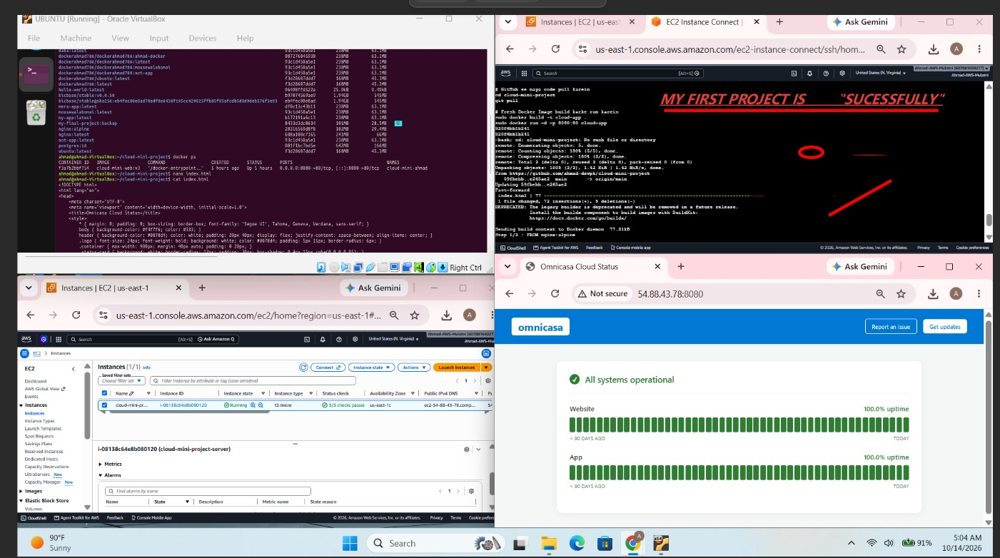

Cloud Mini Project: Ubuntu to AWS Web Server

Project Overview

This is my first Cloud Computing mini project. I created a simple Cloud Status webpage and deployed it on AWS EC2 using Docker.

Technologies Used

- Ubuntu Linux
- HTML
- Docker
- Git and GitHub
- AWS EC2

Project Features

- Created a simple Cloud Status webpage using HTML.
- Built a Docker image using a Dockerfile.
- Ran the application inside a Docker container.
- Deployed the container on an AWS EC2 instance.
- Accessed the webpage through a browser.
- Uploaded the project files to GitHub.

Project Files

- "index.html" — Contains the webpage structure and design.
- "Dockerfile" — Contains the instructions to build the Docker image.

What I Learned

- Working with Ubuntu terminal commands.
- Building Docker images and running containers.
- Understanding port mapping and browser access.
- Deploying a containerized webpage on AWS EC2.
- Using Git and GitHub to save project code.

Deployment Status

The application was successfully deployed and tested on AWS EC2. The AWS resources were later removed to avoid unnecessary costs. The source code remains available in this repository.

Author

Cloud Computing Student

## Deployment Proof

